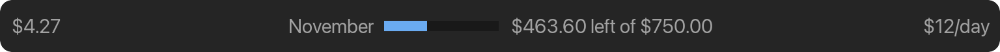

# usage-meter 

A Claude Code mod that shows your usage in a row above the prompt. What it shows depends on your plan.

- **Session cost** at the left: what the current session has cost so far.
- **On a budget plan** (a monthly extra-usage limit, as on Enterprise): a slim bar for the month and how much of the budget is left (block characters in a terminal).
  - **Forecast** at the right edge: the daily rate over the last 7 days (or the month so far). If the budget will run out before the month ends, it adds that date (`$42/day · runs out Nov 24`). The bar and forecast turn yellow, then red, as that date gets closer.
  - A **toast** the first time the month's usage crosses 50%, 75% and 90%, once per month across all your sessions.
- **On a subscription** (Pro or Max): two bars, for the current 5-hour session and for the week. Each bar turns yellow at 75% and red at 90%.


> **Note:** The monthly budget comes from the Claude desktop app's usage tool, so it shows only in the desktop app's Code tab. In `claude` in a plain terminal, you get the session cost and, on a subscription, the 5-hour and weekly bars.

## Install

At the prompt of a Claude Code terminal session:

```
/plugin install usage-meter --marketplace blairj09/usage-meter
```

Answer `y` to add the marketplace, then press Enter to install at the user scope.

From a shell:

```bash
claude plugin install usage-meter --marketplace blairj09/usage-meter
```

In the desktop app, where `/plugin` does not run: click **+** next to the prompt box, then **Plugins** → **Add marketplace** with `blairj09/usage-meter`, then **Add plugin**.

A mod installed at the user scope from a terminal also loads in the desktop app's Code tab.


## Uninstall

```bash
claude plugin uninstall usage-meter
```
