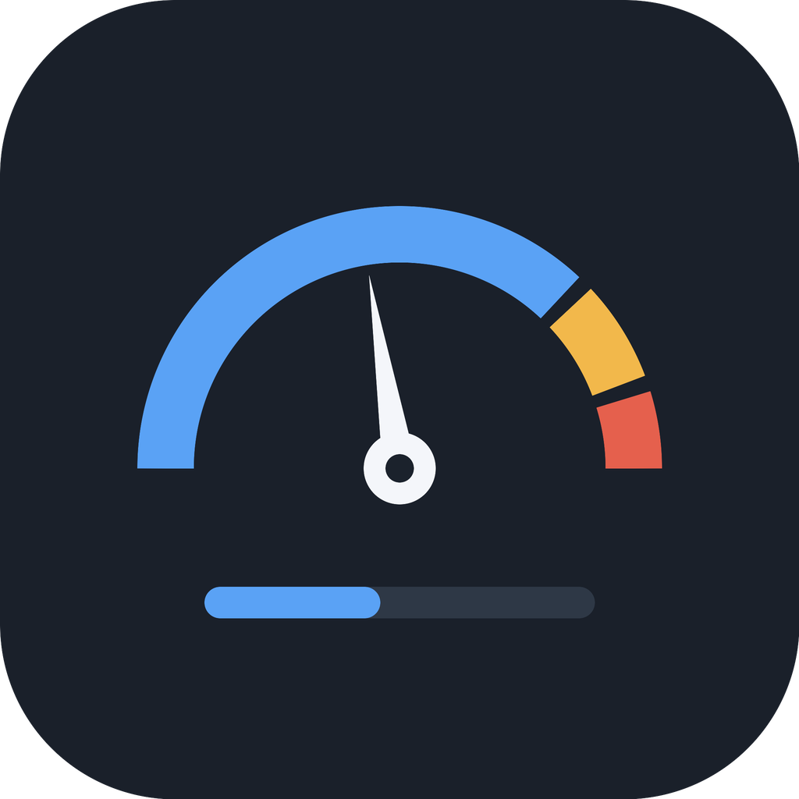

# usage-meter 

A Claude Code mod that shows your usage in a row above the prompt.

- **Session cost** at the left: what the current session has cost so far.
- **Monthly extra usage** against its limit, with a slim bar (block characters in a terminal).
- **Forecast** at the right edge: the daily rate over the last 7 days (or the month so far). If the limit will run out before the month ends, it adds that date (`$42/day · runs out Nov 24`). The bar and forecast turn yellow, then red, as that date gets closer.
- A **toast** the first time the month's usage crosses 50%, 75% and 90%, once per month across all your sessions.


> **Note:** The monthly figures come from the Claude desktop app's usage tool. In the desktop app's Code tab you get everything. In `claude` in a plain terminal, you get the session cost and the rate-limit windows, but not the monthly budget.

## Install

At the prompt of a Claude Code terminal session:

```
/plugin install usage-meter --marketplace blairj09/usage-meter
```

Answer `y` to add the marketplace, then press Enter to install at the user scope.

From a shell:

```bash
claude plugin install usage-meter --marketplace blairj09/usage-meter
```

In the desktop app, where `/plugin` does not run: click **+** next to the prompt box, then **Plugins** → **Add marketplace** with `blairj09/usage-meter`, then **Add plugin**.

A mod installed at the user scope from a terminal also loads in the desktop app's Code tab.


## Uninstall

```bash
claude plugin uninstall usage-meter
```
